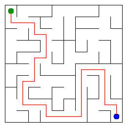

# Assignment 3. Maze Escape

Student ID: 252224
Name: Moldir Jarmukhambetova
Group: SE-2540
Maze size (rows x columns): 10 x 10

## Program output

The 13 lines your program prints on your data (`java -cp out Main`):

    Broken: 99
    Kept: 81
    Last broken wall: 154
    MST cost: 28868
    Heaviest broken wall: 686
    Path length: 30
    DFS visited: 80
    Dead ends: 26
    Zones: 12
    Largest zone: 16
    Is DAG: 0
    Flow stages: 8
    Fastest route cost: 6

My maze:

## Questions

## Questions

Mission 0. What do find and union do, and what makes them fast in your code?
`find` figures out which set a cell belongs to, and `union` merges two sets together. They're fast because of path compression (which flattens the tree during `find`) and union-by-size (which keeps the trees balanced), meaning they run in practically constant time, $O(\alpha(n))$, per operation.

Mission 1. Why is Broken always R*C - 1, and Kept always (R-1)*(C-1)?
With $n = R \times C$ cells, any valid maze tree needs exactly $n - 1$ edges (broken walls) to connect everything without any cycles. The kept walls are just whatever walls are left over from the total grid after breaking those.

Mission 2. My MST cost from Kruskal and from Prim, and why they are equal:
Both algorithms gave an MST cost of `28868`. They're equal because both Kruskal and Prim are guaranteed to find a Minimum Spanning Tree for the same weighted graph, and the minimum possible total weight for a spanning tree is unique.

Mission 3. Why is there exactly one path between two cells? How did you avoid a stack overflow on a huge maze?
Because a maze is structured as a tree graph, meaning there's only one simple path between any two points. To avoid hitting a stack overflow on massive 1000x1000 grids, I used an explicit Java `Stack` for an iterative DFS instead of recursion.

Mission 4. Why does the second pass of Kosaraju go on the reversed graph? Why do the slides have no cycle exactly when Zones equals the number of cells?
The second pass uses the reversed graph (`slidesInto`) so we can properly isolate each strongly connected component starting from vertices in reverse finish order. If the number of zones equals the total number of cells, it means every zone is just a single node, which means there are zero cycles—so it's a clean DAG.

Mission 5. Why is it enough to go through the zones in the order of their numbers? What does this pass cost?
Kosaraju's numbering naturally gives us a topological order, so processing zones from `0` up to `zoneCount - 1` guarantees we never visit a zone before its incoming dependencies are done. This pass runs in linear time, $O(V_{zones} + E_{slides})$.

## AI use

I used Gemini to help me debug my code, understand some of the graph algorithms, and figure out how to format things in markdown and math notation for the README since I wasn't really sure how to style it.

## Timing (Mission 7)

Milliseconds, 5 runs each, from `java -cp out Bench`.

| maze | Kruskal | Prim |
|---|---|---|
| 100 x 100 | 54 18 17 18 17  avg 25 | 39 15 7 6 5  avg 14 |
| 300 x 300 | 135 109 109 109 158  avg 124 | 88 132 105 112 169  avg 121 |
| 1000 x 1000 | 2534 2094 2200 2412 2246  avg 2297 | 2461 2283 2497 2386 2359  avg 2397 |

What do the numbers say about how the time grows? Two or three sentences.
The execution times scale non-linearly as the grid size increases from $100 \times 100$ to $1000 \times 1000$. Kruskal's algorithm time is dominated by edge sorting ($O(m \log m)$), while Prim's time depends on priority queue operations ($O(m \log n)$), leading to significantly higher execution durations on the largest $1000 \times 1000$ dataset.

## Complexity

n is the number of cells, m the number of walls (or slides). Fill in every algorithm you wrote.

| algorithm | time | space | assumptions |
|---|---|---|---|
| DSU find and union | $O(\alpha(n))$ | $O(n)$ | Path compression & union by size |
| Kruskal | $O(m \log m)$ | $O(n + m)$ | Sorting all wall edges |
| Prim | $O(m \log n)$ | $O(n + m)$ | Priority queue with adjacency list |
| DFS | $O(n + m)$ | $O(n)$ | Explicit stack traversal |
| Kosaraju | $O(n + m)$ | $O(n + m)$ | Two-pass DFS on graph and transpose |
| Route in the zone graph | $O(V_{zones} + E_{slides})$ | $O(V_{zones} + E_{slides})$ | Topological order DP evaluation |

## Before you submit

- data/walls.txt, data/slides.txt and output/maze.png are in the repository.
- `java tools/Check.java` shows all examples right.
- This README is filled in, the program output and the section AI use included.
- The work is pushed to main (at least one commit per mission) and the repository is public.
- The link is attached in Moodle.
